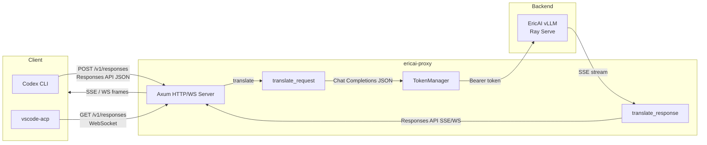

# ericai-proxy

Minimal Rust proxy that translates OpenAI Responses API ↔ Chat Completions for EricAI (vLLM backend).

## Architecture

```
Codex CLI / vscode-acp (codex-acp)
  └─ Sends OpenAI Responses API requests to localhost:8317
      └─ ericai-proxy (Rust) translates:
          ├─ POST /v1/responses → /chat/completions (streaming SSE translation)
          ├─ GET  /v1/responses → WebSocket (same translation over WS)
          ├─ POST /v1/chat/completions → passthrough
          ├─ POST /backend-api/codex/responses/compact → compaction wrapper
          └─ GET  /v1/models → model list from config
              └─ EricAI vLLM (https://ray.sero.gic.ericsson.se/backendsso/v1)
```

### High-Level Data Flow



### Module Overview

| Module | File | Responsibility |
|--------|------|----------------|
| **Server & Routes** | [main.rs](src/main.rs) | Axum HTTP/WebSocket server, all route handlers, request orchestration, context estimation, client-disconnect detection |
| **Config** | [config.rs](src/config.rs) | YAML config loader (`config.yaml`), model alias → backend ID resolution, provider lookup |
| **Auth** | [auth.rs](src/auth.rs) | MSAL OAuth2 token management — loads from disk, auto-refreshes 5 min before expiry, deduplicates concurrent refreshes via mutex, persists refreshed tokens atomically |
| **Request Translation** | [translate_request.rs](src/translate_request.rs) | Converts OpenAI Responses API requests → Chat Completions format (instructions→system message, input array→messages, tools schema, function calls, `custom_tool_call`/`apply_patch` handling, reasoning effort injection) |
| **Response Translation** | [translate_response.rs](src/translate_response.rs) | State machine that converts Chat Completions SSE stream → Responses API SSE events (or raw JSON for WebSocket). Handles thinking/reasoning tags, tool calls, usage aggregation, and non-streaming response conversion |
| **Logger** | [logger.rs](src/logger.rs) | Non-blocking async logger with bounded mpsc channel, background writer task, file rotation (10 MB/file), total size enforcement, per-request error files |

### Request Lifecycle

#### 1. HTTP SSE (`POST /v1/responses`)

```
Codex CLI ──POST /v1/responses──▶ ericai-proxy
  │
  ├─ Parse request JSON, resolve model alias → backend model ID
  ├─ translate_request::responses_to_chat_completions()
  │    ├─ instructions → system message
  │    ├─ input[] → messages[] (handles message, function_call, custom_tool_call, function_call_output)
  │    └─ tools[] → Chat Completions tool schema (apply_patch as freeform function)
  ├─ translate_request::inject_thinking()
  │    ├─ DeepSeek: chat_template_kwargs = {thinking: true, reasoning_effort}
  │    └─ GLM: chat_template_kwargs = {enable_thinking}
  ├─ TokenManager::get_token() → MSAL Bearer token (auto-refresh if expiring)
  ├─ POST {base_url}/chat/completions (streaming SSE)
  │
  │  ┌─ Upstream SSE stream ──────────────────────────────────┐
  │  │  ResponseTranslator::process_line() per SSE data line  │
  │  │  ├─ response.created (first chunk)                     │
  │  │  ├─ response.output_item.added / .done                 │
  │  │  ├─ response.output_text.delta / .done                 │
  │  │  ├─ response.function_call_arguments.delta / .done     │
  │  │  ├─ response.reasoning.delta / .done                   │
  │  │  └─ response.completed (on [DONE])                     │
  │  └────────────────────────────────────────────────────────┘
  │
  ├─ SSE keepalive (: keepalive\n\n) every 15s while waiting
  ├─ Client disconnect detection via mpsc channel send failure → abort upstream
  └─ Stream translated SSE events back to client
```

#### 2. WebSocket (`GET /v1/responses`)

The WebSocket transport is the primary path for Codex's stateful, multi-turn sessions:

```
Codex ACP ──WS upgrade──▶ ericai-proxy
  │
  ├─ Per-connection state:
  │    ├─ response_request_cache: HashMap<response_id, Arc<request_json>>  (max 50, FIFO eviction)
  │    └─ cache_insertion_order: VecDeque<response_id>
  │
  ├─ For each WS text message (one per turn):
  │    ├─ Parse request JSON, extract previous_response_id
  │    ├─ If previous_response_id:
  │    │    ├─ Look up cached full request
  │    │    ├─ Merge: append new input items to cached input[]
  │    │    └─ Append previous assistant output items (messages, tool calls)
  │    │       to rebuilt conversation (vLLM is stateless)
  │    ├─ If generate=false: prewarm handshake — cache request, return response.id
  │    ├─ translate_request → inject_thinking → POST to upstream (streaming)
  │    ├─ ResponseTranslator (raw JSON mode) → WS text frames
  │    ├─ Ping every 15s during upstream wait (prevents idle timeout)
  │    ├─ On stream error/empty: send {type: error} instead of response.completed
  │    └─ After completion: append assistant output to cached request for next turn
  │
  └─ Connection reused across turns until client disconnects
```

#### 3. Compaction (`POST .../responses/compact`)

```
Codex ──POST compact──▶ ericai-proxy
  ├─ translate_request → Chat Completions (streaming)
  ├─ POST to upstream, collect all SSE deltas into single text
  └─ Return {object: "response.compaction", output: [{type: "compaction", summary_text: ...}]}
```

### Authentication Flow

```
                    ┌──────────────────────────────┐
                    │  start.sh (bootstraps token) │
                    │  ericai.sso_auth.get_token() │
                    │  → ~/.cli-proxy-api/         │
                    │    ericai-ericai-user.json   │
                    └──────────┬───────────────────┘
                               │
                    ┌──────────▼───────────────────┐
                    │     TokenManager (auth.rs)   │
                    │  ┌─────────────────────────┐ │
                    │  │ Load token from disk    │ │
                    │  │ at startup              │ │
                    │  └────────┬────────────────┘ │
                    │           │                  │
                    │  ┌────────▼────────────────┐ │
                    │  │ get_token()             │ │
                    │  │  ├─ Fast path: cached   │ │
                    │  │  │  token not expired   │ │
                    │  │  └─ Slow path: refresh  │ │
                    │  │     via MSAL OAuth2     │ │
                    │  │     (mutex dedupes      │ │
                    │  │      concurrent calls)  │ │
                    │  └────────┬────────────────┘ │
                    │           │                  │
                    │  ┌────────▼────────────────┐ │
                    │  │ Atomic write to disk    │ │
                    │  │ (.tmp → rename)         │ │
                    │  └─────────────────────────┘ │
                    └──────────────────────────────┘
                               │
                    ┌──────────▼───────────────────┐
                    │  Bearer token in             │
                    │  Authorization header         │
                    │  → EricAI vLLM backend        │
                    └──────────────────────────────┘
```

- **Token endpoint**: `login.microsoftonline.com` (MSAL OAuth2 v2.0)
- **Refresh trigger**: 5 minutes before `expires_at`
- **Force refresh**: triggered on upstream HTTP 401
- **Concurrency**: mutex held across check-or-refresh; concurrent callers deduplicate on a single refresh

### Scripts

#### `start.sh` — Startup Orchestration

```bash
./start.sh [--restart] [--build] [--rebuild]
```

Sequence:
1. **Stop existing** (`--restart`): kill via PID file, then kill stray processes on port 8317
2. **Build** (`--rebuild` or binary missing): `cargo build --release`
3. **Token refresh**: run `ericai.sso_auth.get_token()` via `uv run` in the `lab` repo, extract MSAL refresh token, write to `~/.cli-proxy-api/ericai-ericai-user.json`
4. **RAM check**: warn if stale trace logs in `/dev/shm/.session-cache` exceed 200 MB
5. **Start proxy**: launch binary, write PID to `/tmp/ericai-proxy-$USER.pid`
6. **Wait for ready**: poll `/v1/models` until responding
7. **Catalog generation**: run `scripts/update_catalog.sh`
8. **Background watcher** (subshell): every 3s checks `config.yaml` hash changes; every 30s runs `scripts/check_health.sh`; regenerates catalog on any change

#### `scripts/update_catalog.sh` — Model Catalog Generation

Generates `~/.codex/model_catalog.json` — the file Codex reads to know which models are available and their capabilities.

1. **Extract schema** from `codex debug models` (canonical field set — adapts to new Codex versions)
2. **Fetch proxy models** from `GET /v1/models` (alias list from config)
3. **Fetch backend metadata** from `ericai api models.list` (context window, health status, GPU info, modalities)
4. **Filter**: only include models that are `HEALTHY` + `loaded` + `running ≥ 1` replica
5. **Build entries**: each entry includes slug, display name, context window, reasoning levels (per-model: DeepSeek/GLM/Kimi/MiMo), truncation policy, supported tools
6. **Schema drift detection**: warn if Codex has fields not in our entries
7. **Atomic write**: `.tmp` → `os.replace()` → final catalog
8. **Validate**: run `codex debug models` again, compare field sets, report stripped/auto-filled fields

#### `scripts/check_health.sh` — Health Monitor

Called every 30s by the `start.sh` watcher. Exits `1` if catalog regeneration is needed.

- Loads current catalog, extracts `ericai_backend_id` set
- Queries `ericai api models.list` for `HEALTHY` backends
- Detects: catalog models that became **unhealthy** (remove them)
- Detects: configured models that became **newly healthy** (add them)
- If any change → exit 1 → watcher calls `update_catalog.sh`

### Key Design Decisions

- **Stateless backend, stateful proxy**: vLLM is stateless (no server-side conversation memory). The proxy maintains a per-WebSocket `response_request_cache` (max 50 entries, FIFO) that rebuilds full conversation history on each `previous_response_id` incremental request.
- **No context trimming**: The proxy does NOT trim conversation context. Codex's own auto-compaction (at 90% of `context_window`) handles this. The previous proxy-side trimming was broken (only counted string content, missed arrays/tool_calls/tools schema).
- **Client disconnect propagation**: HTTP SSE uses an mpsc channel — when the client drops the connection, `tx.send()` fails and the upstream stream is aborted via `CancellationToken`. WebSocket detects dead sockets via failed `socket.send()`.
- **Empty-stream protection**: If upstream returns an empty stream or errors mid-stream, the proxy sends a `{type: "error"}` event instead of `response.completed` — preventing Codex from treating empty turns as successful (which caused degenerate model behavior).
- **Cached model catalog**: `~/.codex/model_catalog.json` is loaded once at startup into an `Arc<Option<Value>>` and shared across all handlers — previously it was read from disk on every request (13+ reads per WebSocket connection).

## Endpoints

| Method | Path | Description |
|--------|------|-------------|
| GET | `/health` | Health check |
| GET | `/v1/models` | List available models |
| POST | `/v1/responses` | Main Responses API (streaming + non-streaming) |
| GET | `/v1/responses` | WebSocket Responses API |
| POST | `/v1/chat/completions` | Chat completions passthrough |
| POST | `/backend-api/codex/responses` | Alias for `/v1/responses` |
| GET | `/backend-api/codex/responses` | WebSocket alias |
| POST | `/backend-api/codex/responses/compact` | Remote compaction v2 |

## Build

```bash
cargo build --release
```

## Run

```bash
# Direct
CONFIG_PATH=./config.yaml ./target/release/ericai-proxy

# Via start.sh (builds + token refresh + catalog generation)
./start.sh
```

## Config

See `config.yaml` — minimal config with only EricAI provider settings.

## Features

- **Request translation**: Responses API → Chat Completions (instructions, input array, tools, function calls, reasoning effort)
- **Response translation**: Chat Completions SSE → Responses API SSE (full event sequence)
- **Thinking injection**: DeepSeek (`thinking: true, reasoning_effort`), GLM (`enable_thinking`)
- **Token management**: MSAL OAuth refresh, auto-refresh 5min before expiry
- **Remote compaction**: Wraps chat completion as `response.compaction` object
- **WebSocket support**: Stateful Responses WS transport for Codex — `generate=false` prewarm handshake, connection reuse across turns, and `previous_response_id` incremental-input expansion (rebuilds full history for the stateless vLLM backend)
- **Model aliasing**: Config aliases (e.g. `glm-5.2` → `zai-org/GLM-5.2-FP8`)
